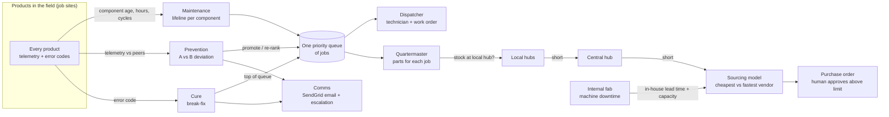

# PitCrew v0.2 — Prevention · Cure · Maintenance, on an iron-tight supply chain

Status: working idea, 2026-10-23 (hackathon day). Written to be handed to Claude for polishing — see
[Notes for Claude](#notes-for-claude-polishing-this) at the end.

**One line:** every product we have in the field gets a lifeline, a peer comparison and an alarm; those
three feed **one priority queue** of jobs; and a supply chain built around a **central hub and local hubs**
makes sure the part is already near the site before the technician leaves.

**Customer for the challenge: NXP Semiconductors.** The v0.1 demo used a simulated solar-tower fleet as
the "product in the field"; for NXP the story needs to be re-pointed at semiconductor manufacturing (see
open questions in section 12). "Internal fab" in the sketch fits a wafer fab directly: tool downtime there
hits manufacturing and the supply chain.

Current UI design canvas (four boards from v0.1):
https://claude.ai/artifact/1S9Qbm5vMK6qFEgKWrNb3n
- A · Run · Mill — clean SaaS
- B · Run · Mill — PitCrew accent
- C · Run · Mill — A + race design
- C · Operator alerts (Comms agent): email/SMS to the floor, acknowledgment, escalation

---

## 1. What changed from v0.1

v0.1 (this repo's initial commit, PitCrew v0.1.0) was organised as **Run · Improve · Grow**. The team has re-cut it into
three service loops plus a supply chain. The whiteboard sketch:

```
          ┌──> Prevention
          ├──> Cure
          ├──> Schedule Prevention   (= Maintenance)
          │
          └──> Iron-tight supply chain
                   ├──> Sourcing        (outside: vendors, inventory, hubs)
                   └──> Internal fab    (inside: factory machine downtime) — Hari
```

| v0.1 | v0.2 | What happens to it |
|---|---|---|
| Run · Towers (Sentinel → Diagnostician → Race Engineer → Quartermaster → Dispatcher) | **Prevention** and **Cure** | Same crew pattern; detection becomes "this product vs its peers" and "this product threw an error code" |
| — | **Maintenance** | New: component lifelines create scheduled jobs ahead of time |
| Quartermaster (`ops.py`: one parts room, `best_quote`) | **Sourcing** | Grows into a multi-hub inventory + demand forecast + vendor comparison (cheapest vs fastest) |
| Run · Mill (VM-07, Lift & Coast, AI4I data) | **Internal fab** | Becomes the factory view: machine downtime → production and spare-part lead times |
| Operator alerts board (Comms agent) | **Cure notifications** | Email goes out through **SendGrid** |
| Improve (Kaizen), Grow (passports, sensor slots) | Out of scope for now | Keep as stretch unless the team decides otherwise |

What stays: tools are the only way agents touch state, every number on an approval card comes from a tool
result, policy gates (POs above a limit need a human), offline fallback when Bedrock fails.

---

## 2. The big picture



Three ways a job is born, one queue, one parts system:

| Loop | Trigger | Urgency | Owner |
|---|---|---|---|
| **Cure** | Product throws error codes / goes down | Highest — customer has downtime now | Team (crew + SendGrid) |
| **Prevention** | Product A behaves worse than its peers B (less telemetry, more error codes, worse performance) | Moves jobs up the queue in proportion to how different A is | Matthew (failure-prediction model) |
| **Maintenance** | A component reaches the end of its lifeline | Planned weeks ahead | Teammate (maintenance pipeline) |
| **Sourcing** | Upcoming jobs + emergency buffer exceed stock | Order at the right time | Mudit (with Claude) |
| **Internal fab** | Factory machine downtime | Changes production and in-house part lead times | Hari |

---

## 3. Maintenance — lifelines (scheduled prevention)

**Idea:** every component of every fielded product has a lifeline. When the lifeline says a component is
due, a job lands in the queue early enough that parts and people are ready.

- **Lifeline** = rated life of the component (from the manual or datasheet; public-safe values only) in
  whatever unit wears it out: calendar days, operating hours, cycles (drive starts), energy throughput.
- **Consumed life** = usage since install, from telemetry (e.g. hours run, starts counted).
- **Due date** = date when consumed life reaches a threshold (e.g. 90% of rated life), projected from the
  recent usage rate.
- **Lead window** = how far ahead the job is created: at least the longest part lead time plus route
  planning time (e.g. 30 days), so Sourcing has room to buy at the cheapest price.
- **Batching:** jobs at the same site inside the same window ride on one truck roll (v0.1 already batches
  tower visits on the Thursday/Friday DFW route).

Output into the queue: `job(type=maintenance, product, component, due_by, parts[], est_hours, site)`.

The teammate owning this pipeline defines the lifeline table; the rest of the system only needs the
`job` shape above.

---

## 4. Prevention — product A vs product B

**Idea:** a product that starts behaving differently from its peers is probably wearing faster than its
lifeline assumes. The more different it is, the sooner it should be visited.

**Peer group (B):** same model, same site or region (same weather), similar age. Comparing against peers
instead of a fixed threshold cancels weather and season: if every tower at a site makes less energy on a
cloudy day, none of them is flagged.

**Signals compared (A vs B median):**

| Signal | Why it matters | Bad direction |
|---|---|---|
| Telemetry messages per hour | Fewer messages = comms or controller trouble, or a product going dark | Lower |
| Error codes per day (by code family) | Warnings usually rise before a hard failure | Higher |
| Performance ratio (actual / expected output) | Losing output means losing the customer's money | Lower |
| Effort per unit of work (e.g. drive energy per degree moved) | Rising friction / wear (v0.1 already models this for towers) | Higher |

**Deviation score:** robust z-score of A against its peers, per signal, then take the worst one.

```
z_signal = (x_A - median_B) / (1.4826 * MAD_B)       # signed so that "worse" is positive
D        = max over signals of z_signal, also trend over the last 7 days
```

| D | Meaning | What the crew does |
|---|---|---|
| < 2 | Normal | Nothing |
| 2 – 3 | Watch | Bring the next maintenance job forward; check parts at the local hub |
| > 3 | Act | Create or promote a job; due date from the remaining-life estimate; notify the local site; reserve parts — if the local hub doesn't have them, start a transfer from the nearest hub that does |

**Parts diversion when a job is promoted:**
1. Local hub has it → reserve.
2. Else nearest other hub whose stock stays above its own emergency buffer after the transfer → transfer.
3. Else central hub → transfer.
4. Else Sourcing → **fastest** option (the cheap option rarely arrives in time once a job is promoted).

---

## 5. Cure — the product is down

**Idea:** an error code that means "down" or "about to go down" beats everything else in the queue,
because the customer has downtime now.

1. **Sentinel** sees the error code(s) and opens an incident.
2. **Diagnostician** maps the code to the likely failed component and parts list (manuals; error-code table).
3. **Scheduler** puts a priority job at the top of the queue; if a technician is already on a route nearby,
   it reroutes them.
4. **Quartermaster** pulls the part from the nearest hub with stock (same ladder as Prevention, fastest
   first).
5. **Comms** sends email through **SendGrid** to the local site lead and the technician (customer
   notification optional), with: what failed, what to bring, when the job is booked. It tracks
   acknowledgment and escalates if nobody answers (the Alerts board already designs this: SEV levels,
   10-minute escalation rule, external emails wait for manager approval).
6. **Dispatcher** creates the work order; on close, the technician records the failure mode — this feeds
   back into lifelines and peer baselines.

SendGrid notes: API key in AWS Secrets Manager (never in the repo); single-sender verification is enough
for the demo; dynamic templates per SEV level; the Event Webhook can report delivered/opened to fill the
"Drafted → Sent → Delivered → Opened → Acknowledged" strip on the Alerts board.

---

## 6. One priority queue

All three loops write into the same queue so a technician sees one list and a part is never promised
twice.

| Field | Example |
|---|---|
| `job_id` | `JOB-1042` |
| `type` | `cure` / `prevention` / `maintenance` |
| `product_id`, `site`, `local_hub` | Tower 19, Data center lot, Local hub North |
| `component`, `parts[]` | slew drive seal, `SEAL-KIT-SD ×1` |
| `due_by` | date |
| `priority` | number, higher first |
| `parts_status` | `reserved at local hub` / `transfer in transit (ETA)` / `on order (PO, ETA)` / `short` |
| `tech`, `route_day` | Rosa M., Thursday route |
| `evidence[]` | telemetry chart, error codes, peer comparison |

**Ordering rule (simple first version):**
- Cure always ranks first; among cures, highest downtime cost per hour first.
- Prevention next, by `D × consequence` (cost of the failure it prevents).
- Maintenance by `due_by`.
- A prevention signal on a product that already has a maintenance job pulls that job forward instead of
  creating a second one.
- Jobs at the same site within a few days merge into one visit.

---

## 7. Iron-tight supply chain

### 7a. Sourcing (outside) — Mudit

**Question it answers:** for every part, at every hub, *do we have enough for the jobs coming up plus a few
spare for emergencies — and if not, when do we order, and from whom?*

**Inputs**
- Inventory per hub: on hand, reserved, inbound (POs and transfers with ETAs).
- Demand from the queue over a horizon T (e.g. 30 days):
  - scheduled demand — parts on maintenance jobs due in T;
  - predicted demand — parts on prevention-flagged products, weighted by probability of needing them in T;
  - emergency buffer — "a couple extra" per part per hub (start with a fixed number, e.g. 2; later size it
    from the cure history: `buffer = z · σ_daily · √lead_time`).
- Authorized vendor list per part: unit price, shipping to each hub, lead time, minimum order quantity,
  on-time rate, field reliability (v0.1's `Quote.field_mtbf_years`).
- Internal fab as one more "vendor" for parts we make ourselves; its lead time comes from Hari's model.

**Model**

```
position(h, p)  = on_hand - reserved + inbound_before(need_by)
need(h, p, T)   = scheduled + predicted + buffer
shortfall       = need - position                     # order if > 0
order_qty       = max(shortfall, MOQ), rounded to pack size
need_by         = first date the projected stock drops below the buffer (walk the dated jobs)
order_by(v)     = need_by - lead_time(v) - transit(v -> hub)
```

**Output: an order card with two options**
- **Cheapest** — lowest landed cost (price × qty + shipping) among vendors that arrive by `need_by`.
- **Fastest** — earliest arrival, whatever the price.
- Plus **when to order**: "order by Oct 25" (if the cheapest option can still wait, say so — no reason to
  buy early), and a warning if *no* vendor arrives in time → transfer from another hub or expedite.

**Worked example** (placeholder numbers, not real prices):

Part `SEAL-KIT-SD` at Local hub North, today Oct 23. On hand 3, reserved 1 → 2 available, nothing inbound.
Jobs: maintenance Oct 28 (1), maintenance Nov 4 (1), prevention-flagged tower ~Nov 2 (p = 0.7 → 0.7).
Buffer 2.

- Need over 30 days = 1 + 1 + 0.7 + 2 = 4.7; position = 2 → shortfall 2.7 → order 3 (no MOQ).
- Projected stock falls below the buffer on Oct 28 → `need_by = Oct 28`.

| Vendor | Unit | Lead time | Arrives | In time? | Landed cost (3) |
|---|---|---|---|---|---|
| Vendor X | $58 | 10 days | Nov 2 | No | $174 |
| DriveParts TX | $65 | 3 days | Oct 26 | Yes | $195 |
| Vendor Y | $72 | 1 day | Oct 24 | Yes | $216 |

Card: **Cheapest in time: DriveParts TX, $195, order by Oct 25. Fastest: Vendor Y, arrives Oct 24.**
Vendor X is cheapest overall but late; the card says so in one line. $195 is under the $500 auto-approve
limit (`ops.py: POLICY`), so it goes out without a human; above the limit it waits for approval.

v0.1 code to grow from: `pitcrew/ops.py` (`Part`, `Quote`, `best_quote` — already "cheapest that arrives
in time, never the cheapest that arrives late", `draft_po`, `POLICY`). What's new: multiple hubs, demand
from the queue, buffer, order-by date, and returning both cheapest and fastest instead of one pick.

### 7b. Internal fab (inside) — Hari

**Question it answers:** when a factory machine goes down or degrades, what does that do to production of
new products and of the spare parts we make in-house?

- Machine health and downtime risk per machine (v0.1's VM-07 mill, AI4I 2020 failure rules, Lift & Coast:
  derate to reach the next shift change instead of stopping).
- Output to Sourcing: **in-house capacity and lead time per part** for the next T days. If downtime pushes
  the in-house lead time past a job's `need_by`, Sourcing flips that part to an outside vendor.
- The fab's own consumables (cutting inserts etc.) are parts like any other: they go through the same
  sourcing model (v0.1 already reorders `INSERT-CNMG-L` this way).

**Interface between 7a and 7b** (agree this early):
`fab_forecast(part) -> {units_per_day, lead_time_days, confidence, reason}`.

### 7c. Hub network

- **Central hub** — next to the factory, holds most of the inventory, supplies manufacturing and
  replenishes local hubs.
- **Local hubs** — small stock of fast-moving parts near job-site clusters that are far from the centre,
  so a technician can pick up a part the same day.
- Moves: vendor → central (normal replenishment), vendor → local (direct, when fastest), central → local
  (replenishment), local ↔ local (urgent lateral transfer for Cure/Prevention).
- Needs: a transit-time table between hubs and from each vendor to each hub.

For the demo: 1 central hub + 3 local hubs, one per v0.1 site cluster (DFW warehouse roof, Data center lot,
Open field Ellis County — 48 simulated towers in `pitcrew/tower.py`). Names and locations are placeholders.

---

## 8. Agents (crew) for v0.2

| Agent | Does | Built on |
|---|---|---|
| Sentinel | Reads telemetry + error codes for every product; computes peer deviation; opens Cure incidents | v0.1 Sentinel, `tower.py` detectors |
| Diagnostician | Error code / signal → likely component and parts list, citing the manual | v0.1 Diagnostician, `search_manual` |
| Scheduler (new) | Owns the priority queue: lifeline jobs, promotions, merges, re-ranks | Teammate's maintenance pipeline |
| Quartermaster | Hub inventory, reservations, transfers, the sourcing model (cheapest vs fastest), POs | v0.1 Quartermaster, `ops.py` |
| Dispatcher | Technician, route, work order | v0.1 Dispatcher |
| Comms | SendGrid email, acknowledgment, escalation | Alerts board design |
| Fab Engineer | Factory machine downtime → capacity and lead time | v0.1 Race Engineer on the mill (Hari) |

**Human gates (policy):** POs above $500, any change to how a machine runs, any external email (to a
customer or vendor) wait for a person. Cure dispatch and internal emails go out automatically.

**AWS:** Strands Agents on Bedrock, deployed to Bedrock AgentCore Runtime (v0.1 already has
`agentcore/agent.py`); tools behind AgentCore Gateway; policy as AgentCore Policy (Cedar). Telemetry is
simulated for the demo (in production: IoT Core → a time-series store). A nightly scheduled run (EventBridge)
recomputes lifelines, peer scores and the sourcing plan. SendGrid key in Secrets Manager.

---

## 9. UI — the network is the home screen

Home is a map: the **central hub in the middle** with its inventory, **local hubs** around it, **job sites**
around each local hub. Everything else is a side panel.

```
┌─────────────────────────────────────────────────────────────────────────────────┐
│ PitCrew · Network      Cure 1 · Prevention 3 · Maintenance 12      Crew on Bedrock │
├────────────────┬─────────────────────────────────────────────────┬──────────────┤
│ PRIORITY QUEUE │                  NETWORK MAP                    │ DETAIL       │
│ ● CURE   T-19  │      ○ ○ sites            ○ ○ sites             │ (whatever is │
│ ● PREV   T-07  │        \                    /                   │  clicked:    │
│ ● MAINT  T-31  │     [Local hub N] ─────┐  ┌── [Local hub W]      │  job, hub,   │
│ ● MAINT  T-42  │                  [ CENTRAL HUB ]                │  product,    │
│   ...          │                  [  + factory  ]  ⇠ vendors     │  order card) │
│                │     [Local hub S] ─────┘                        │              │
├────────────────┴─────────────────────────────────────────────────┴──────────────┤
│ TIMELINE  today ── jobs ── transfers in transit ── POs arriving ── fab downtime │
└─────────────────────────────────────────────────────────────────────────────────┘
```

- **Sites** coloured by state: healthy / maintenance due / prevention flag / cure (down).
- **Lines** animate what is moving: part transfers between hubs, POs from vendors, technician to site.
- **Click a hub** → stock vs upcoming demand + buffer per part, and the order card (cheapest vs fastest,
  order-by date).
- **Click a product** → its telemetry next to its peers' band (the A vs B picture), error codes, lifeline
  of each component.
- **Click the central hub / factory** → Internal fab view (Hari): machine health, downtime, lead times.

How the existing design boards map:

| Existing board | v0.2 use |
|---|---|
| A / B / C · Run · Mill | Becomes the Internal fab drill-down (pick one visual style for the whole app) |
| C · Operator alerts (Comms agent) | Cure notifications via SendGrid — keep almost as is |
| New: Network map | Home screen above |
| New: Priority queue | Left panel; also a full-page view for the dispatcher |
| New: Product vs peers | Prevention evidence |
| New: Hub stock + order card | Sourcing output |

---

## 10. Demo story (about 3 minutes)

1. **Network.** Central hub, three local hubs, 48 towers. Queue shows maintenance jobs created from
   lifelines weeks ahead; parts already reserved.
2. **Prevention.** Tower 7 is sending 30% fewer messages and 4× the warning codes of its 15 peers at the
   same site → D = 3.4 → its maintenance job jumps from next month to Thursday's route. Local hub has no
   seal kit → transfer from central, arrives tomorrow. Site lead gets an email.
3. **Cure.** Tower 19 throws a stall error → top of the queue → SendGrid email to site lead and technician,
   acknowledgment tracked, escalation timer visible. Part pulled from the local hub; technician rerouted.
4. **Sourcing.** Those two jobs pushed Local hub North's seal kits below demand + buffer → order card:
   cheapest in time vs fastest, order by Oct 25. Under $500 → auto-approved.
5. **Internal fab.** A mill in the factory is near its power limit → Lift & Coast keeps it running to shift
   change → in-house drive production slips 2 days → Sourcing switches one part to an outside vendor.

(All numbers above are illustrative; in the app every number must come from a tool result.)

---

## 11. Data needed

| Data | Used by | Demo source |
|---|---|---|
| Products: id, model, site, install date, components | All | `tower.py` Fleet (48 towers, 3 sites, lots A/B/C) |
| Component lifelines: rated life + unit | Maintenance | Manuals in `data/manuals/` (public-safe values) |
| Telemetry: per product per hour — message count, performance, effort | Prevention | Simulated from `tower.py` |
| Error codes: code, severity, product, time | Cure, Prevention | Simulated; need an error-code table |
| Hubs: location, transit times | Sourcing | Placeholder table |
| Inventory per hub per part | Sourcing | Extend `ops.py` `Part` with `hub` |
| Authorized vendors per part | Sourcing | Extend `ops.py` `Quote` |
| Factory machines + downtime | Internal fab | AI4I 2020 (`mill.py`) |

---

## 12. Open questions for the team

- What is the "product in the field" for NXP? Options: (a) fab and test equipment across NXP's sites
  (components with lifelines, spare parts at hubs — closest to this plan); (b) NXP chips in customers'
  systems reporting telemetry and error codes; (c) keep the simulated solar towers as a stand-in.
- Which hackathon datasets/APIs does NXP provide, and do the walls/signals in `mill.py` (AI4I) still fit?
- Who owns the UI, and which board style (A clean / B accent / C race) do we keep?
- How many hubs and where? What are the transit times?
- Error-code table: which codes mean "down" (Cure) vs "warning" (Prevention signal)?
- SendGrid: whose account; send to customers or only internal people for the demo?
- Downtime cost per hour per product (needed to rank Cure jobs against each other).
- The interface between Maintenance (teammate), Sourcing (Mudit) and Internal fab (Hari): agree on the
  `job` and `fab_forecast` shapes in sections 3, 6 and 7b before splitting up.
- Do Kaizen (Improve) and passports (Grow) from v0.1 stay in the pitch as a closing "and it learns" beat?

---

## Notes for Claude (polishing this)

You are helping a hackathon team (Austin Agentic AI Hackathon, Track 2: Autonomic Shop Floor & Predictive
Maintenance) refine this idea. The code base is PitCrew v0.1.0 (Python, Strands Agents, Bedrock AgentCore,
Shiny console); the UI design canvas is linked at the top.

- **Keep:** the three loops (Prevention, Cure, Maintenance) feeding one priority queue; the central/local hub
  network; Sourcing returning *cheapest vs fastest* with an *order-by* date; SendGrid for Cure; the owners
  in section 2; "every number on screen comes from a tool"; human approval above policy limits.
- **Improve:** make the pitch sharper; tighten the priority rule and the deviation score so they are easy to
  explain to judges; check the sourcing math; propose the Network map board and the order card in the same
  visual language as the existing boards; cut anything that won't fit a one-day build.
- **Ask, don't invent:** prices, error codes, hub locations, component lifetimes — use clearly labelled
  placeholders. No company names or proprietary values go into the repo.
